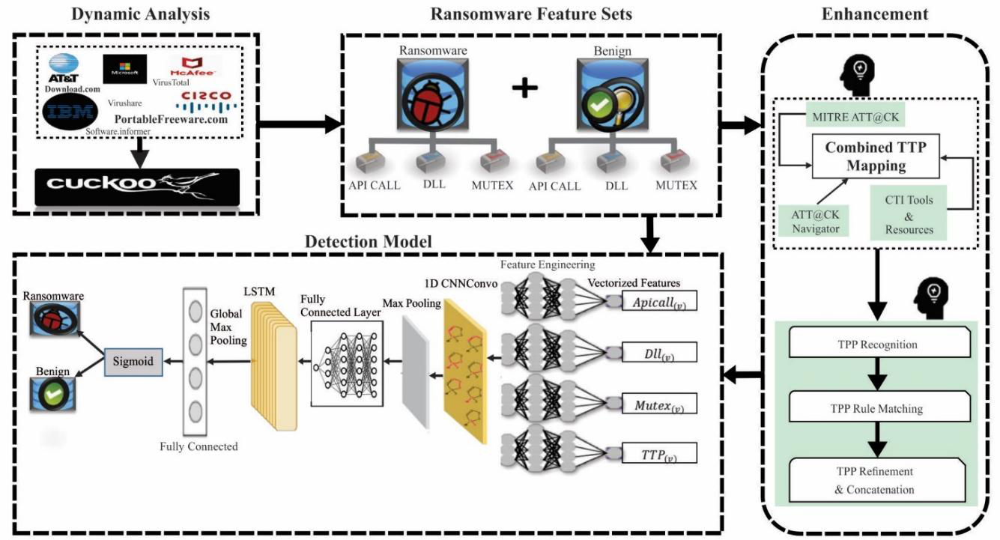
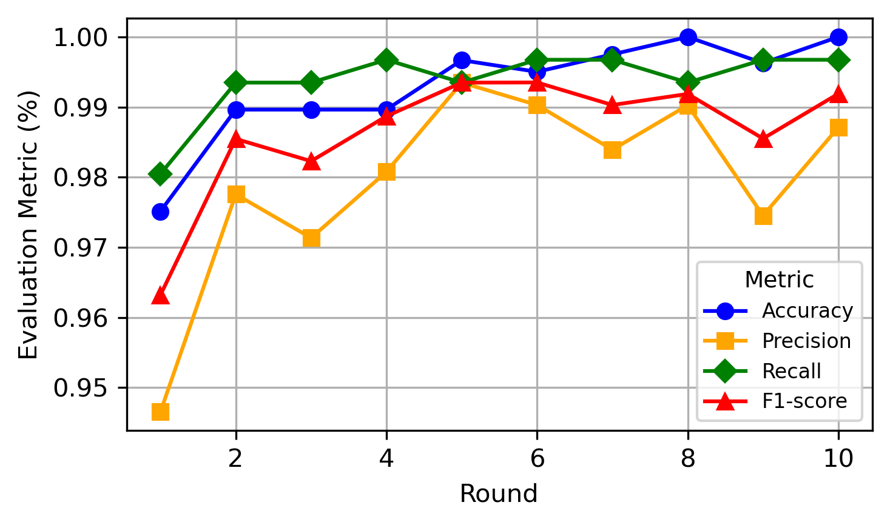
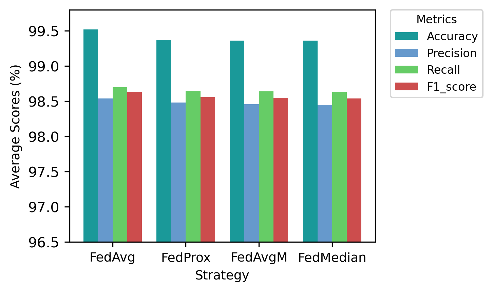
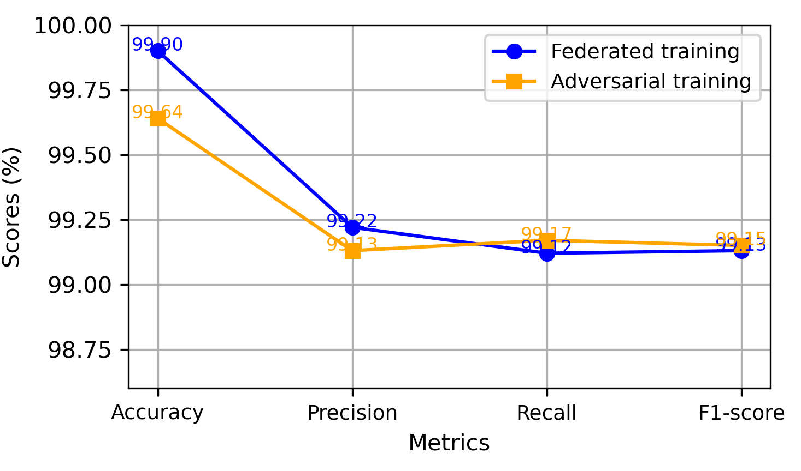
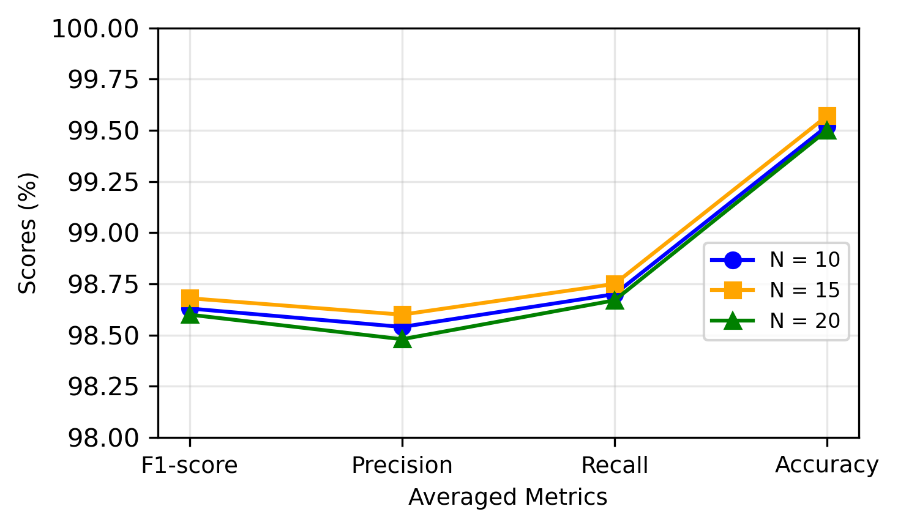
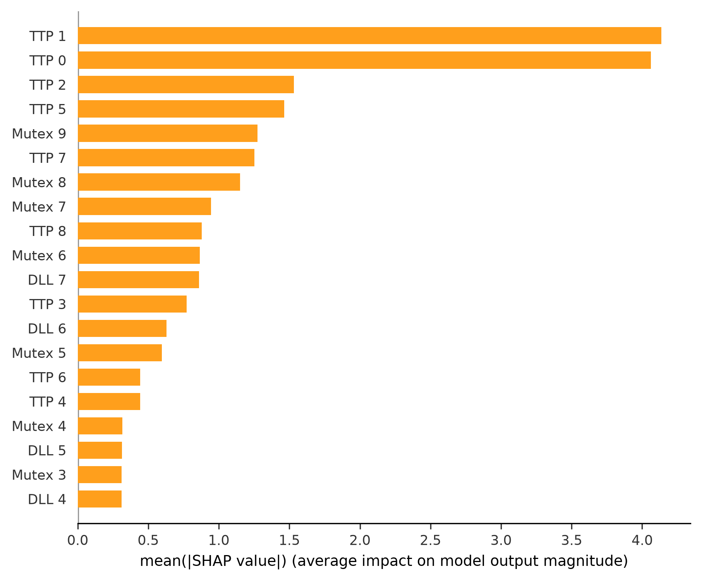
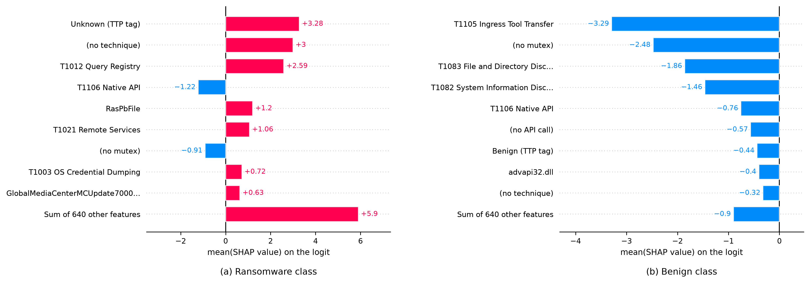
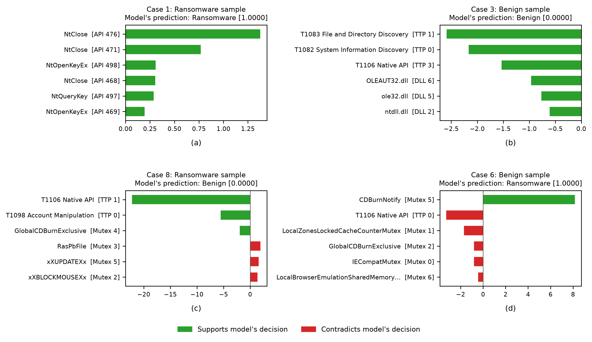

# RS-FEDRAD: Robust and Scalable Federated Ransomware Detection Using a TTP-Enhanced Dataset

[](https://doi.org/10.52783/jisem.v10i43s.8490)
[](LICENSE)
[](data/README.md)

This repository contains the implementation, data, trained model and results of **RS-FEDRAD**, published in the *Journal of Information Systems Engineering and Management* (2025). RS-FEDRAD lets several organisations train a common ransomware detector without exchanging their behavioural telemetry. Each organisation records API calls, DLL interactions and mutex operations of executed samples, maps them to MITRE ATT&CK techniques, and trains a hybrid CNN-LSTM locally; a Flower server aggregates the local models into a global detector.

We additionally provide an explainability study with LIME and SHAP that shows which behaviours and which ATT&CK techniques drive the decisions of the federated model.

<p align="center">
  
  <br><em>General workflow of RS-FEDRAD (Fig. 1 of the article).</em>
</p>

## Contents

1. [Highlights](#highlights)
2. [TTP-enhanced dataset](#ttp-enhanced-dataset)
3. [Method](#method)
4. [Results](#results)
5. [Explainability with LIME and SHAP](#explainability-with-lime-and-shap)
6. [Repository structure](#repository-structure)
7. [Installation](#installation)
8. [Reproducing the experiments](#reproducing-the-experiments)
9. [Limitations](#limitations)
10. [Citation](#citation)
11. [References](#references)

## Highlights

* A TTP-enhanced dataset of 30,150 behavioural sequences (51% ransomware, 49% benign) in which every API call, DLL and mutex trace is annotated with the ATT&CK techniques it realises.
* A hybrid CNN-LSTM trained with federated averaging across ten clients, reaching **99.90% accuracy** and an F1-score of 99.13% in the final round, with an average federated accuracy of **99.52%** over ten rounds.
* Experiments on four aggregation rules (FedAvg, FedProx, FedAvgM, FedMedian), centralised versus federated training, adversarial training with FGSM and BIM, and scaling from 10 to 20 clients.
* A LIME and SHAP analysis of the global model, following the XRan protocol (Gulmez et al., 2024), that quantifies the share of each decision carried by the TTP features.

## TTP-enhanced dataset

The dataset combines three ransomware collections (ISOT, VirusShare, SOREL-20M) and one benign collection, executed in Cuckoo Sandbox with cross-validation of the traces on ANY.RUN, ThreatGrid and Sysmon logs. Each sample is a sequence of 530 positions:

| Positions | Feature | Example values |
|---|---|---|
| 0 to 499 | API calls in order of invocation | `NtAllocateVirtualMemory`, `RegOpenKeyExW` |
| 500 to 509 | loaded DLLs | `ADVAPI32dll`, `bcryptdll` |
| 510 to 519 | mutexes | `LocalZonesCacheCounterMutex` |
| 520 to 529 | ATT&CK techniques | `T1055` Process Injection, `T1012` Query Registry |

Techniques are assigned by aligning the API, DLL and mutex events of a sample, scoring them against technique profiles with cosine similarity and the Jaccard index, and validating every mapping with the ATT&CK Navigator and manual review. The full dataset is in [`data/clients/`](data/clients), already split into the ten federated clients (3,015 samples each). The dataset card in [`data/README.md`](data/README.md) lists sources, feature statistics and the thirteen techniques that occur.

## Method

**Client-side preprocessing.** Every client works only with its own data:

1. By first filling its  empty positions with the most frequent value;
2. The label-encodes each position;
3. Scales the codes to [0, 1] and standardises them;
4. Finally,  hold out a stratified 20% split for evaluation.

No vocabulary or statistic leaves the client.

**Detector.** Algorithm 1 of the paper defines the hybrid CNN-LSTM:

| Layer | Configuration |
|---|---|
| Conv1D | 64 filters, kernel size 3, ReLU |
| MaxPooling1D | pool size 2 |
| LSTM | 100 units |
| Dense | 64 units, ReLU |
| Dropout | 0.5 |
| Dense | 1 unit, sigmoid |

The model is trained with Adam (learning rate 0.001) and binary cross-entropy. The convolution captures local patterns among neighbouring events, and the LSTM models the order of the execution trace.

**Federated training.** We use Flower with ten clients. In each of the ten communication rounds, the server sends the global weights to all clients. Each client trains for ten local epochs with batch size 64 and returns its weights and metrics. The server then aggregates the weights with FedAvg. The same pipeline also supports FedProx, FedAvgM and FedMedian, adversarial training with FGSM or BIM examples, and re-partitioning of the data into 15 or 20 clients. All hyperparameters are in [`configs/default.yaml`](configs/default.yaml).

## Results

Our output builds from the client logs in [`results/logs/federated`](results/logs/federated) by `python -m rsfedrad.aggregate_logs`. In these logs, accuracy is the local accuracy at the end of each round, while precision, recall and F1-score are measured on the client's held-out split; global values are means over the ten clients.

### Federated training (FedAvg, 10 clients)

| Round | Accuracy | Precision | Recall | F1-score |
|---:|---:|---:|---:|---:|
| 1 | 98.56 | 97.87 | 97.49 | 97.66 |
| 2 | 99.17 | 97.58 | 98.76 | 98.16 |
| 3 | 99.51 | 97.86 | 98.66 | 98.27 |
| 4 | 99.39 | 98.52 | 98.34 | 98.52 |
| 5 | 99.71 | 98.75 | 98.86 | 98.87 |
| 6 | 99.70 | 98.82 | 98.98 | 98.94 |
| 7 | 99.63 | 98.99 | 98.86 | 98.92 |
| 8 | 99.83 | 98.90 | 99.08 | 98.99 |
| 9 | 99.82 | 98.93 | 98.79 | 98.86 |
| 10 | **99.90** | **99.22** | **99.12** | **99.13** |
| Mean | 99.52 | 98.54 | 98.69 | 98.63 |

<p align="center">
  
  <br><em>Performance across the ten federated rounds (Fig. 3 of the article).</em>
</p>

Evaluations performance achieved a mean accuracy of 99.507% (SD 0.035), precision 98.539% (SD 0.044), recall 98.695% (SD 0.050), F1-score 98.622% (SD 0.047) and AUC-ROC 99.59% (SD 0.032).

### Aggregation strategies

| Strategy | Accuracy | Precision | Recall | F1-score |
|---|---:|---:|---:|---:|
| **FedAvg** | **99.52** | **98.54** | **98.69** | **98.63** |
| FedProx | 99.37 | 98.48 | 98.65 | 98.56 |
| FedAvgM | 99.36 | 98.46 | 98.64 | 98.55 |
| FedMedian | 99.36 | 98.45 | 98.63 | 98.54 |

<p align="center">
  
  <br><em>Average performance of the aggregation strategies (Fig. 4 of the article).</em>
</p>

FedAvg performs best on our client distribution, which is close to IID. FedProx's proximal term and FedAvgM's server momentum bring no benefit here. FedMedian trades a little accuracy for robustness to outlying client updates.

### Centralised versus federated training and adversarial robustness

| Mode | Accuracy | Precision | Recall | F1-score |
|---|---:|---:|---:|---:|
| Centralised | 99.12 | 99.10 | 99.31 | 99.20 |
| Federated | **99.90** | 99.22 | 99.12 | 99.13 |
| Adversarial training (FGSM/BIM) | 99.64 | 99.13 | **99.17** | **99.15** |

Federated training matches the centralised model while keeping the data on the clients. Adding FGSM and BIM examples to the local training data lowers accuracy by only 0.26 percentage points.

<p align="center">
  
  <br><em>Federated versus adversarial training (Fig. 5 of the article).</em>
</p>

### Scalability

| Clients | Accuracy | Precision | Recall | F1-score |
|---:|---:|---:|---:|---:|
| 10 | 99.52 | 98.54 | 98.70 | 98.63 |
| 15 | 99.57 | 98.60 | 98.75 | 98.68 |
| 20 | 99.50 | 98.48 | 98.67 | 98.60 |

Accuracy stays between 99.50% and 99.57% as the number of participants doubles.

<p align="center">
  
  <br><em>Scalability across 10, 15 and 20 clients (Fig. 6 of the article).</em>
</p>

Comparisons with deep learning and federated detectors from the literature are given in Figs. 7 and 8 of the article.

## Explainability with LIME and SHAP

High detection rates are only useful to an analyst if the reasons behind a decision can be inspected. Therefore, we explain the global model after ten FedAvg rounds ([`models/rsfedrad_global_round10.h5`](models)) with LIME (Ribeiro et al., 2016) and SHAP (Lundberg and Lee, 2017). We follow the protocol of XRan (Gulmez et al., 2024), whose behavioural traces we extended with ATT&CK techniques: LIME for local explanations of correct and incorrect decisions, and SHAP for location-based and feature-based global explanations. Since RS-FEDRAD adds a TTP block to the sequence, we also measure which share of each decision this block carries, a question XRan didn't address.

**Setup.** The explanations cover the held-out splits of all ten clients (6,030 sequences). The global model misclassifies 48 of them: 24 benign samples flagged as ransomware and 24 missed ransomware samples. Every encoded position is mapped back to its readable value with the client's encoder, and positions that were empty in the raw trace are shown as `<empty>`.

* **LIME.** For a given sequence we remove random subsets of its observed events, replacing each removed position with the value of an empty slot, as LIME removes words from a document. We then fit a weighted linear surrogate to the model's log-odds over 5,000 perturbations. A positive weight means the observed API call, DLL, mutex or technique pushes the decision towards ransomware. We explain two correctly classified ransomware samples, two correctly classified benign samples, and the two most confident errors of each kind.
* **SHAP.** We compute expected-gradient SHAP values on the pre-sigmoid logit, using 200 background sequences and 400 explained sequences (200 per class). The attributions add up to the model output: their sum correlates with f(x) - E[f] at r = 0.983.

### Which part of the sequence matters

| Feature group | Positions | Share of total \|SHAP\| | Mean \|SHAP\| per position |
|---|---:|---:|---:|
| API calls | 500 | 12.1% | 0.007 |
| DLLs | 10 | 12.9% | 0.365 |
| Mutexes | 10 | 22.1% | 0.625 |
| **TTPs** | 10 | **52.9%** | **1.498** |

The ten TTP positions carry more than half of every decision. A single TTP position is on average about 220 times as influential as a single API position, and the first two technique slots alone account for 29% of the total attribution. This answers the question of how the TTP enhancement enters the model's decisions: the technique annotations are the dominant evidence.

Inside the API block, 86% of the attribution falls on the last 70 positions (430 to 499) and almost none on the first 100. This differs from XRan, where the earliest API calls dominated. Two properties of our setting explain it. First, these positions record whether a trace is long enough to reach them. Second, the LSTM reads the sequence from left to right, so events close to the DLL, mutex and TTP blocks lie nearest to its final state.

<p align="center">
  
  <br><em>Location-based global explanation: the twenty most influential positions of the sequence.</em>
</p>

### Which techniques and behaviours point to ransomware

<p align="center">
  
  <br><em>Feature-based global explanation of (a) the ransomware class and (b) the benign class. Each bar is the mean SHAP value of an API call, DLL, mutex or technique over the samples of the class. "(no ...)" stands for empty positions, and "TTP tag" marks the Unknown and Benign labels of the TTP block.</em>
</p>

**Techniques.** The techniques with the largest positive contributions are:
* *Unknown*, the tag for behaviour that matched no known profile;
* T1012 Query Registry;
* T1021 Remote Services;
* T1003 OS Credential Dumping;
* T1098 Account Manipulation;
* T1073 DLL Side-Loading.

T1105 Ingress Tool Transfer, T1083 File and Directory Discovery and T1082 System Information Discovery point to benign software.

The signs agree with our data. In the TTP-enhanced dataset, benign and ransomware samples share only one technique, T1106 Native API, which is common in legitimate software as well. The model has learned this partition of the technique space, and T1106 is accordingly the technique with the most ambiguous role.

**DLLs, mutexes and API calls.** Among the other features, the strongest ransomware indicators are:
* **DLLs:** the authentication and security libraries `sechost.dll`, `lsasrv.dll`, `SspiSrv.dll` and `SspiCli.dll`;
* **Mutexes:** `RasPbFile`, `LocalZonesLockedCacheCounterMutex` and the Media Center `MCStoreSyncMem` mutexes;
* **API calls:** `NtDelayExecution`, often used to stall sandbox analysis, together with the file-metadata calls `GetFileSizeEx`, `GetFileInformationByHandleEx` and `SetFileTime`, which are typical of the file enumeration and tampering that accompany encryption.

Benign evidence comes from GUI and versioning libraries (`COMCTL32.dll`, `VERSION.dll`) and Explorer thumbnail-cache mutexes. XRan also reported `Sechost.dll` and the Zones cache mutexes. That overlap is consistent with our use of the same underlying traces. The attribution of every value is listed in [`shap_value_attributions.csv`](results/explainability/shap_value_attributions.csv).

### Local explanations of correct and incorrect decisions

| Case | Sample | P(ransomware) | Main evidence (LIME) | Local R² |
|---:|---|---:|---|---:|
| 1 | ransomware, correct | 1.000 | repeated `NtClose`, `NtOpenKeyEx` and `NtQueryKey` at the end of the trace | 0.85 |
| 2 | ransomware, correct | 1.000 | Media Center `mcepg` mutexes, registry access calls | 0.70 |
| 3 | benign, correct | 0.000 | T1083 and T1082 in the first TTP slots, `OLEAUT32.dll`, `ole32.dll` | 0.46 |
| 4 | benign, correct | 0.000 | T1083 and T1105, `ole32.dll`, `SHELL32.dll` | 0.82 |
| 5 | benign, flagged as ransomware | 1.000 | `RstrMgr` and thumbnail-cache mutexes | 0.41 |
| 6 | benign, flagged as ransomware | 1.000 | `CDBurnNotify` mutex | 0.84 |
| 7 | ransomware, missed | 0.000 | T1098 and T1106 in TTP slots 0 and 1 | 0.90 |
| 8 | ransomware, missed | 0.000 | T1106 in TTP slot 1 outweighs `xXBLOCKMOUSEXx`, `xXPASSWORDLISTXx`, `xXUPDATEXx`, `RasPbFile` | 0.95 |

The errors are informative.

* **Missed ransomware.** Both missed samples carry T1106 Native API, the one technique that also occurs in benign software, in their second technique slot, and the model follows it. In case 8, LIME still finds strong ransomware evidence in the mutexes (`xXBLOCKMOUSEXx`, `xXPASSWORDLISTXx`), but it is outweighed by the leading technique.
* **Benign samples flagged as ransomware.** These are driven by single mutexes that the model associates with ransomware, such as `CDBurnNotify` and the Restart Manager session mutex.

This mirrors the observation in XRan that individual indicators can mislead the detector when they are read in isolation. It also indicates where the TTP mapping could be refined: a finer split of T1106 by the native calls behind it would remove the main source of missed detections.

<p align="center">
  
  <br><em>LIME explanations of (a) a correctly classified ransomware sample, (b) a correctly classified benign sample, (c) a missed ransomware sample and (d) a benign sample flagged as ransomware. The value in brackets is the predicted probability of ransomware, and the square brackets give the position of each event.</em>
</p>

All explanations, attribution tables and figures are in [`results/explainability/`](results/explainability). They are discussed in [`notebooks/03_explainability.ipynb`](notebooks/03_explainability.ipynb) and reproduced with `python -m rsfedrad.explain`.

## Repository structure

```
RS-FEDRAD-PROJECT/
├── configs/default.yaml           # all hyperparameters of the study
├── data/
│   ├── README.md                  # dataset card
│   └── clients/client_01..10.csv.gz
├── models/
│   └── rsfedrad_global_round10.h5 # global CNN-LSTM after 10 FedAvg rounds
├── notebooks/
│   ├── 01_dataset_and_encoding.ipynb
│   ├── 02_reported_results.ipynb
│   └── 03_explainability.ipynb
├── results/
│   ├── tables/                    # reported results (CSV)
│   ├── figures/                   # figures of the article
│   ├── logs/federated/            # original per-client training logs
│   └── explainability/            # LIME and SHAP outputs
├── src/rsfedrad/
│   ├── encoding.py                # client-side encoding and decoding
│   ├── data.py                    # client data, splits, re-partitioning
│   ├── model.py                   # hybrid CNN-LSTM
│   ├── client.py                  # Flower client (plain or adversarial training)
│   ├── server.py                  # Flower server, aggregation strategies, checkpoints
│   ├── simulate.py                # whole federation in one process
│   ├── centralized.py             # centralised baseline
│   ├── adversarial.py             # FGSM and BIM
│   ├── aggregate_logs.py          # rebuilds the round-wise results from client logs
│   └── explain.py                 # LIME and SHAP analysis
└── tests/
```

## Installation

Python 3.10 to 3.12 is required.

```bash
git clone https://github.com/EmpireNetwork123/RS-FEDRAD-PROJECT.git
cd RS-FEDRAD-PROJECT
python -m venv .venv
source .venv/bin/activate          # Windows: .venv\Scripts\activate
pip install -r requirements.txt
pip install -e .
```

We conducted this experiment with Python 3.12, TensorFlow 2 and Flower on a laptop with an Intel Core i7-1165G7 and 32 GB of RAM. 
## Reproducing the experiments

All commands are run from the repository root.

**Reported results**

```bash
python -m rsfedrad.aggregate_logs        # per-round table from the client logs
```

**Federated training**, one terminal for the server and one per client:

```bash
python -m rsfedrad.server                          # FedAvg, 10 rounds
python -m rsfedrad.client --client-id 1            # repeat for ids 1 to 10
```

or the whole federation in a single process:

```bash
python -m rsfedrad.simulate                                  # FedAvg, 10 clients
python -m rsfedrad.simulate --strategy fedprox               # fedavg | fedprox | fedavgm | fedmedian
python -m rsfedrad.simulate --num-clients 20                 # scalability
python -m rsfedrad.simulate --attack fgsm                    # adversarial training (fgsm | bim)
python -m rsfedrad.centralized                               # centralised baseline
```

New runs write their logs and global models to `runs/`. Retraining on other hardware or library versions will produce slightly different numbers.

**Explainability**

```bash
python -m rsfedrad.explain               # about 20 minutes on a laptop CPU
python -m rsfedrad.explain --figures-only    # redraw the figures from the saved explanations
```

**Tests**

```bash
pip install -r requirements-dev.txt
pytest
```

## Limitations
* Encoding is fitted per client, so the same API call can receive different codes on different clients. This keeps vocabularies private, but it also means the global model has to learn client-specific codes. A shared, privacy-preserving vocabulary is a direction for future work.
* LIME and SHAP explain the behaviour of the model, not causal properties of the samples. Attributions of rare values are estimated from few occurrences.

## Citation

If you use this code or the dataset, please cite:

```bibtex
@article{ali2025rsfedrad,
  title   = {{RS-FEDRAD}: Robust and Scalable Federated Ransomware Detection Using {TTP}-Enhanced Dataset},
  author  = {Ali, Chinonso E. and Lu, Songfeng and Ruambo, Francis A. and Tchamini, Francelle},
  journal = {Journal of Information Systems Engineering and Management},
  volume  = {10},
  number  = {43s},
  pages   = {876--891},
  year    = {2025},
  doi     = {10.52783/jisem.v10i43s.8490}
}
```

## References

* Beutel, D. J., et al. (2020). Flower: A Friendly Federated Learning Framework. *arXiv:2007.14390*.
* Goodfellow, I. J., Shlens, J., & Szegedy, C. (2015). Explaining and Harnessing Adversarial Examples. *ICLR*.
* Gulmez, S., Gorgulu Kakisim, A., & Sogukpinar, I. (2024). XRan: Explainable deep learning-based ransomware detection using dynamic analysis. *Computers & Security*, 139, 103703.
* Kurakin, A., Goodfellow, I., & Bengio, S. (2017). Adversarial Examples in the Physical World. *ICLR Workshop*.
* Lundberg, S. M., & Lee, S.-I. (2017). A Unified Approach to Interpreting Model Predictions. *NeurIPS*.
* McMahan, B., Moore, E., Ramage, D., Hampson, S., & Arcas, B. A. y. (2017). Communication-Efficient Learning of Deep Networks from Decentralized Data. *AISTATS*.
* MITRE ATT&CK. https://attack.mitre.org/
* Ribeiro, M. T., Singh, S., & Guestrin, C. (2016). "Why Should I Trust You?": Explaining the Predictions of Any Classifier. *KDD*.

## License

The code is released under the [MIT License](LICENSE). The TTP-enhanced dataset is released under [CC BY 4.0](https://creativecommons.org/licenses/by/4.0/).
